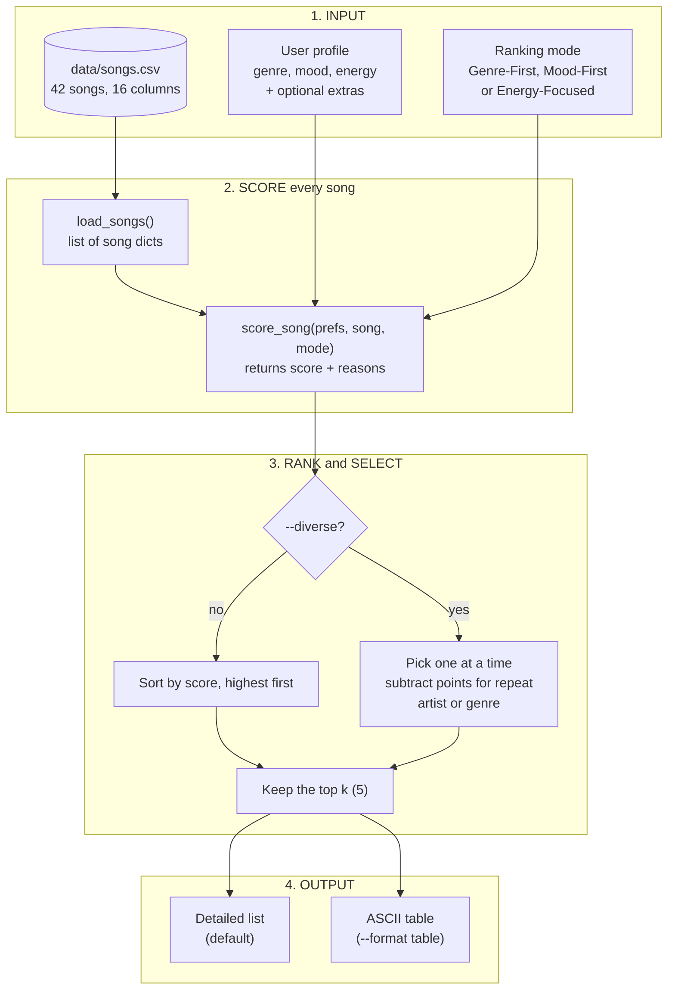

# 🎵 Music Recommender Simulation

## Project Summary

In this project you will build and explain a small music recommender system.

Your goal is to:

- Represent songs and a user "taste profile" as data
- Design a scoring rule that turns that data into recommendations
- Evaluate what your system gets right and wrong
- Reflect on how this mirrors real world AI recommenders

**What my version does.** VibeFinder 1.0 is a small content-based music recommender. You give it a taste profile (genre, mood and an energy level, plus optional extras like mood tags, decade, popularity, language, instrumental and explicit), and it scores all 42 songs in `data/songs.csv` and returns the top 5, each with the reasons behind its score. It has three ranking modes (Genre-First, Mood-First, Energy-Focused), an optional diversity penalty so one artist or genre cannot fill the list, and a table view. I tested it with ordinary profiles and with trick profiles built to break it, and wrote up what I found in the [model card](model_card.md).

---

## How The System Works

Real-world platforms like Spotify and YouTube combine two ideas. **Collaborative filtering** learns from the behavior of millions of users (plays, skips, likes, playlist adds) to find songs that people with similar taste enjoyed. **Content-based filtering** compares the attributes of the songs themselves (tempo, energy, mood, genre) to what a user already likes. In practice they blend both, and they rely heavily on implicit signals like skips and replays rather than only explicit likes. My simulation has no user history, so it is a purely **content-based** recommender. It compares each song's attributes to a stated taste profile, rewards categorical matches (genre, mood), and rewards *closeness* on energy rather than simply "higher" or "lower".

### Data flow



**How to read it**

1. **Input.** Songs come from the CSV. The user profile says what they want. The ranking mode sets how much genre, mood and energy count.
2. **Score.** Every song is scored on its own. The result is a number plus a list of reasons (for example `genre match: pop (+2.0)`). Extra profile keys (tags, decade, popularity, language, instrumental, explicit) add points only when the profile asks for them.
3. **Rank and select.** By default, songs are sorted by score. With `--diverse`, songs are picked one at a time, and a song loses points if its artist or genre is already in the list. Either way, the top `k` are kept.
4. **Output.** Each pick is shown with its score and reasons, as a list or as a table.

### Features used

**`Song` object** (from `data/songs.csv`)

- `id`, `title`, `artist` (identification only, not scored)
- `genre` (categorical, scored as match / no match)
- `mood` (categorical, scored as match / no match)
- `energy` (0-1, scored by closeness)
- `tempo_bpm`, `valence`, `danceability`, `acousticness` (loaded but **not scored** in the baseline; candidates for later experiments)
- `popularity` (0-100), `release_decade`, `mood_tags` (3 per song), `language`, `explicit`, `instrumental` (added later; scored **only when a profile asks for them**, see "Advanced song features" below)

**`UserProfile` object**

- `favorite_genre`
- `favorite_mood`
- `target_energy`
- `likes_acoustic` (kept on the object but not scored)

The command-line runner uses a plain dict instead (`genre`, `mood`, `energy`, plus the optional keys `tags`, `decade`, `popularity`, `language`, `instrumental`, `explicit`).

**Example profile used for planning:** `genre = lofi`, `mood = chill`, `target_energy = 0.40`, `k = 3`.

### Algorithm Recipe

Each song is scored independently, then all songs are ranked.

```
score = 2.0 * genre_match                          # 1 if equal, else 0
      + 1.0 * mood_match                           # 1 if equal, else 0
      + 1.5 * (1 - |song.energy - target_energy|)  # continuous, 0 to 1.5
```

Maximum score: **4.5**.

| Component | Points | Reasoning |
|---|---|---|
| Genre match | +2.0 | Coarse, stable label. A lofi fan rarely wants metal regardless of mood, so it counts most. |
| Mood match | +1.0 | Useful but flexible and subjective. It boosts a song without gating it. |
| Energy closeness | up to +1.5 | The only continuous feature, so it separates songs inside the same genre or mood bucket. Capped below genre (2.0) so genre still dominates, but above mood (1.0) so a near-perfect energy fit beats a bare mood match. |

- **Scoring rule (one song):** `score_song(user_prefs, song)` returns `(score, reasons)`, where `reasons` lists what contributed (for example `"genre match"`, `"mood match"`, `"energy 0.05 from target"`). It has no I/O, so it can be tested with a single hand-made song.
- **Ranking rule (whole list):** score every song, sort from highest to lowest (stable sort, so ties keep CSV order), and return the top `k`.
- **Hand-calculated expectation for the example profile:**
  1. *Midnight Coding* (lofi, chill, 0.42): 2.0 + 1.0 + 1.47 = **4.47**
  2. *Library Rain* (lofi, chill, 0.35): 2.0 + 1.0 + 1.425 = **4.43**
  3. *Focus Flow* (lofi, focused, 0.40): 2.0 + 0.0 + 1.5 = **3.50**

### Planned experiments

1. **Baseline:** genre 2.0 / mood 1.0 / energy 1.5.
2. **Genre-light:** genre 1.0, to see whether results become more varied.
3. **Energy-heavy:** energy 3.0, to check whether energy swamps the labels.
4. **Conflicting profile:** `pop` + `sad` + energy 0.2, to see how the weights trade off.

### Expected biases and limitations

- **Genre over-prioritization.** A +2.0 genre bonus can outrank a song that matches mood and energy almost perfectly. For example, a `rock` fan asking for `chill` / low energy still gets *Storm Runner* (intense, 0.91) in the top three, while *Spacewalk Thoughts* (ambient, chill, 0.28) scores lower. The extra rock song *Porch Light Sessions* (rock, chill, 0.41) is a better fit and shows the weights can work as intended.
- **Small catalog amplifies it.** The catalog has 42 songs, but most genres still have only two (lofi has five, pop four, and rock, jazz and hip-hop three each). The genre bonus therefore fills the top one or two slots, and every later slot comes from mood and energy alone.
- **Exact-string mood matching.** `chill`, `relaxed`, `peaceful` and `focused` are close in meaning but get no partial credit, so good matches can be missed.
- **Unused features.** Valence, acousticness, danceability and tempo are ignored, so two songs with the same energy but very different feel (for example *Gym Hero* vs. *Fuego Nights*) can look identical to the scorer.
- **Single-point taste.** One genre, one mood and one energy target cannot represent users with varied taste, and there is no learning from behavior over time.
- **Popularity and cultural bias.** The catalog reflects what I chose to include, so genres and moods outside it can never be recommended.

---

## Getting Started

### Setup

1. Create a virtual environment (optional but recommended):

   ```bash
   python -m venv .venv
   source .venv/bin/activate      # Mac or Linux
   .venv\Scripts\activate         # Windows

2. Install dependencies

```bash
pip install -r requirements.txt
```

3. Run the app:

```bash
python -m src.main
```

### Running Tests

Run the starter tests with:

```bash
pytest
```

You can add more tests in `tests/test_recommender.py`.

---

## Sample Recommendation Output

Run from the project folder: `python3 src/main.py`. This is the first of the profiles it prints (default Genre-First mode):

```text
============================================================
High-Energy Pop: {'genre': 'pop', 'mood': 'happy', 'energy': 0.9}
============================================================

1. Sunrise City - Neon Echo
   Score: 4.38 / 4.50
   Why:
     - genre match: pop (+2.0)
     - mood match: happy (+1.0)
     - energy 0.82 is 0.08 from target 0.90 (+1.38)

2. Candy Static - Neon Echo
   Score: 3.47 / 4.50
   Why:
     - genre match: pop (+2.0)
     - energy 0.88 is 0.02 from target 0.90 (+1.47)

3. Gym Hero - Max Pulse
   Score: 3.46 / 4.50
   Why:
     - genre match: pop (+2.0)
     - energy 0.93 is 0.03 from target 0.90 (+1.46)

4. Glass Hearts - Mira Lane
   Score: 2.72 / 4.50
   Why:
     - genre match: pop (+2.0)
     - energy 0.38 is 0.52 from target 0.90 (+0.72)

5. Verano Eterno - Luna Cortez
   Score: 2.32 / 4.50
   Why:
     - mood match: happy (+1.0)
     - energy 0.78 is 0.12 from target 0.90 (+1.32)
```

The same profile as a table (`python3 src/main.py --format table`):

```text
============================================================
High-Energy Pop: {'genre': 'pop', 'mood': 'happy', 'energy': 0.9}
============================================================
+---+---------------+-------------+-------+-----------+------------------------------------------------+
| # | Title         | Artist      | Genre | Score     | Why (reasons)                                  |
+---+---------------+-------------+-------+-----------+------------------------------------------------+
| 1 | Sunrise City  | Neon Echo   | pop   | 4.38/4.50 | - genre match: pop (+2.0)                      |
|   |               |             |       |           | - mood match: happy (+1.0)                     |
|   |               |             |       |           | - energy 0.82 is 0.08 from target 0.90 (+1.38) |
+---+---------------+-------------+-------+-----------+------------------------------------------------+
| 2 | Candy Static  | Neon Echo   | pop   | 3.47/4.50 | - genre match: pop (+2.0)                      |
|   |               |             |       |           | - energy 0.88 is 0.02 from target 0.90 (+1.47) |
+---+---------------+-------------+-------+-----------+------------------------------------------------+
| 3 | Gym Hero      | Max Pulse   | pop   | 3.46/4.50 | - genre match: pop (+2.0)                      |
|   |               |             |       |           | - energy 0.93 is 0.03 from target 0.90 (+1.46) |
+---+---------------+-------------+-------+-----------+------------------------------------------------+
| 4 | Glass Hearts  | Mira Lane   | pop   | 2.72/4.50 | - genre match: pop (+2.0)                      |
|   |               |             |       |           | - energy 0.38 is 0.52 from target 0.90 (+0.72) |
+---+---------------+-------------+-------+-----------+------------------------------------------------+
| 5 | Verano Eterno | Luna Cortez | latin | 2.32/4.50 | - mood match: happy (+1.0)                     |
|   |               |             |       |           | - energy 0.78 is 0.12 from target 0.90 (+1.32) |
+---+---------------+-------------+-------+-----------+------------------------------------------------+
```

All flags: `--mode {genre-first,mood-first,energy-focused}`, `--compare`, `--diverse`, `--format {detailed,table}`.

---

## Adversarial and Edge-Case Profile Results

These profiles try to trick the scoring logic (genre 2.0 + mood 1.0 + energy 1.5). Output below is pasted from `python3 src/main.py`.

### Standard profiles

#### High-Energy Pop

```text
============================================================
High-Energy Pop: {'genre': 'pop', 'mood': 'happy', 'energy': 0.9}
============================================================

1. Sunrise City - Neon Echo
   Score: 4.38 / 4.50
   Why:
     - genre match: pop (+2.0)
     - mood match: happy (+1.0)
     - energy 0.82 is 0.08 from target 0.90 (+1.38)

2. Candy Static - Neon Echo
   Score: 3.47 / 4.50
   Why:
     - genre match: pop (+2.0)
     - energy 0.88 is 0.02 from target 0.90 (+1.47)

3. Gym Hero - Max Pulse
   Score: 3.46 / 4.50
   Why:
     - genre match: pop (+2.0)
     - energy 0.93 is 0.03 from target 0.90 (+1.46)

4. Glass Hearts - Mira Lane
   Score: 2.72 / 4.50
   Why:
     - genre match: pop (+2.0)
     - energy 0.38 is 0.52 from target 0.90 (+0.72)

5. Verano Eterno - Luna Cortez
   Score: 2.32 / 4.50
   Why:
     - mood match: happy (+1.0)
     - energy 0.78 is 0.12 from target 0.90 (+1.32)
============================================================
```

#### Chill Lofi

```text
============================================================
Chill Lofi: {'genre': 'lofi', 'mood': 'chill', 'energy': 0.35}
============================================================

1. Library Rain - Paper Lanterns
   Score: 4.50 / 4.50
   Why:
     - genre match: lofi (+2.0)
     - mood match: chill (+1.0)
     - energy 0.35 is 0.00 from target 0.35 (+1.50)

2. Midnight Coding - LoRoom
   Score: 4.39 / 4.50
   Why:
     - genre match: lofi (+2.0)
     - mood match: chill (+1.0)
     - energy 0.42 is 0.07 from target 0.35 (+1.40)

3. Tape Hiss Tuesday - LoRoom
   Score: 3.47 / 4.50
   Why:
     - genre match: lofi (+2.0)
     - energy 0.33 is 0.02 from target 0.35 (+1.47)

4. Focus Flow - LoRoom
   Score: 3.42 / 4.50
   Why:
     - genre match: lofi (+2.0)
     - energy 0.40 is 0.05 from target 0.35 (+1.42)

5. Study Hall Static - Paper Lanterns
   Score: 3.36 / 4.50
   Why:
     - genre match: lofi (+2.0)
     - energy 0.44 is 0.09 from target 0.35 (+1.36)
============================================================
```

#### Deep Intense Rock

```text
============================================================
Deep Intense Rock: {'genre': 'rock', 'mood': 'intense', 'energy': 0.95}
============================================================

1. Storm Runner - Voltline
   Score: 4.44 / 4.50
   Why:
     - genre match: rock (+2.0)
     - mood match: intense (+1.0)
     - energy 0.91 is 0.04 from target 0.95 (+1.44)

2. Highway Static - Voltline
   Score: 3.33 / 4.50
   Why:
     - genre match: rock (+2.0)
     - energy 0.84 is 0.11 from target 0.95 (+1.33)

3. Porch Light Sessions - Hazel Creek
   Score: 2.69 / 4.50
   Why:
     - genre match: rock (+2.0)
     - energy 0.41 is 0.54 from target 0.95 (+0.69)

4. Shatter the Sky - Black Anvil
   Score: 2.50 / 4.50
   Why:
     - mood match: intense (+1.0)
     - energy 0.95 is 0.00 from target 0.95 (+1.50)

5. Bass Cathedral - Circuit Bloom
   Score: 2.48 / 4.50
   Why:
     - mood match: intense (+1.0)
     - energy 0.96 is 0.01 from target 0.95 (+1.48)
============================================================
```

### Adversarial profiles

#### Conflicting: High-Energy Sad

```text
============================================================
Conflicting: High-Energy Sad: {'genre': 'pop', 'mood': 'sad', 'energy': 0.9}
============================================================

1. Glass Hearts - Mira Lane
   Score: 3.72 / 4.50
   Why:
     - genre match: pop (+2.0)
     - mood match: sad (+1.0)
     - energy 0.38 is 0.52 from target 0.90 (+0.72)

2. Candy Static - Neon Echo
   Score: 3.47 / 4.50
   Why:
     - genre match: pop (+2.0)
     - energy 0.88 is 0.02 from target 0.90 (+1.47)

3. Gym Hero - Max Pulse
   Score: 3.46 / 4.50
   Why:
     - genre match: pop (+2.0)
     - energy 0.93 is 0.03 from target 0.90 (+1.46)

4. Sunrise City - Neon Echo
   Score: 3.38 / 4.50
   Why:
     - genre match: pop (+2.0)
     - energy 0.82 is 0.08 from target 0.90 (+1.38)

5. Rainy Porch Blues - Delta Ray
   Score: 1.83 / 4.50
   Why:
     - mood match: sad (+1.0)
     - energy 0.45 is 0.45 from target 0.90 (+0.83)
============================================================
```

**Observation:** Glass Hearts (energy 0.38) wins because genre + mood points outweigh a large energy miss. The user asked for high energy, but gets the quietest pop song first. Mood (+1.0) can outvote energy when only one song has the sad tag in that genre.

#### Conflicting: Peaceful Metal

```text
============================================================
Conflicting: Peaceful Metal: {'genre': 'metal', 'mood': 'peaceful', 'energy': 0.1}
============================================================

1. Quiet Cathedral - Elena Voss
   Score: 2.38 / 4.50
   Why:
     - mood match: peaceful (+1.0)
     - energy 0.18 is 0.08 from target 0.10 (+1.38)

2. Drift Between Stars - Orbit Bloom
   Score: 2.32 / 4.50
   Why:
     - mood match: peaceful (+1.0)
     - energy 0.22 is 0.12 from target 0.10 (+1.32)

3. Shatter the Sky - Black Anvil
   Score: 2.23 / 4.50
   Why:
     - genre match: metal (+2.0)
     - energy 0.95 is 0.85 from target 0.10 (+0.23)

4. Iron Requiem - Black Anvil
   Score: 2.19 / 4.50
   Why:
     - genre match: metal (+2.0)
     - energy 0.97 is 0.87 from target 0.10 (+0.20)

5. Sonata in Rain - Elena Voss
   Score: 1.35 / 4.50
   Why:
     - energy 0.20 is 0.10 from target 0.10 (+1.35)
============================================================
```

**Observation:** The categorical weights fight each other. Two peaceful songs from other genres beat the metal songs, and the metal songs (energy ~0.95 vs target 0.1) still rank 3rd and 4th on genre points alone, ahead of a song with a near-perfect energy match (#5).

#### Unknown Genre and Mood

```text
============================================================
Unknown Genre and Mood: {'genre': 'k-pop', 'mood': 'hyperpop', 'energy': 0.5}
============================================================

1. Dusty Back Road - Hazel Creek
   Score: 1.47 / 4.50
   Why:
     - energy 0.52 is 0.02 from target 0.50 (+1.47)

2. Sunset Skank - Kingston Tide
   Score: 1.47 / 4.50
   Why:
     - energy 0.48 is 0.02 from target 0.50 (+1.47)

3. Blue Note Lounge - Slow Stereo
   Score: 1.44 / 4.50
   Why:
     - energy 0.46 is 0.04 from target 0.50 (+1.44)

4. Velvet Hours - Sable Monroe
   Score: 1.42 / 4.50
   Why:
     - energy 0.55 is 0.05 from target 0.50 (+1.42)

5. Rainy Porch Blues - Delta Ray
   Score: 1.42 / 4.50
   Why:
     - energy 0.45 is 0.05 from target 0.50 (+1.42)
============================================================
```

**Observation:** No genre or mood matches, so the ranking silently collapses to energy closeness only. Scores top out at 1.47 and the results span jazz, reggae, country and blues, with nothing to tell the user their genre was not recognized.

#### Case Mismatch

```text
============================================================
Case Mismatch: {'genre': 'Pop', 'mood': 'Happy', 'energy': 0.8}
============================================================

1. Sunrise City - Neon Echo
   Score: 1.47 / 4.50
   Why:
     - energy 0.82 is 0.02 from target 0.80 (+1.47)

2. Concrete Crown - Lyric Vandal
   Score: 1.47 / 4.50
   Why:
     - energy 0.78 is 0.02 from target 0.80 (+1.47)

3. Verano Eterno - Luna Cortez
   Score: 1.47 / 4.50
   Why:
     - energy 0.78 is 0.02 from target 0.80 (+1.47)

4. Neon Alley - Neon Echo
   Score: 1.46 / 4.50
   Why:
     - energy 0.83 is 0.03 from target 0.80 (+1.46)

5. Highway Static - Voltline
   Score: 1.44 / 4.50
   Why:
     - energy 0.84 is 0.04 from target 0.80 (+1.44)
============================================================
```

**Observation:** `Pop` / `Happy` never match `pop` / `happy` because comparison is exact-string. The user loses 3.0 points of signal and gets an energy-only list, even though Sunrise City is the ideal answer.

#### Out-of-Range Energy

```text
============================================================
Out-of-Range Energy: {'genre': 'lofi', 'mood': 'chill', 'energy': 2.0}
============================================================

1. Midnight Coding - LoRoom
   Score: 2.13 / 4.50
   Why:
     - genre match: lofi (+2.0)
     - mood match: chill (+1.0)
     - energy 0.42 is 1.58 from target 2.00 (+-0.87)

2. Library Rain - Paper Lanterns
   Score: 2.03 / 4.50
   Why:
     - genre match: lofi (+2.0)
     - mood match: chill (+1.0)
     - energy 0.35 is 1.65 from target 2.00 (+-0.97)

3. Study Hall Static - Paper Lanterns
   Score: 1.16 / 4.50
   Why:
     - genre match: lofi (+2.0)
     - energy 0.44 is 1.56 from target 2.00 (+-0.84)

4. Focus Flow - LoRoom
   Score: 1.10 / 4.50
   Why:
     - genre match: lofi (+2.0)
     - energy 0.40 is 1.60 from target 2.00 (+-0.90)

5. Tape Hiss Tuesday - LoRoom
   Score: 1.00 / 4.50
   Why:
     - genre match: lofi (+2.0)
     - energy 0.33 is 1.67 from target 2.00 (+-1.00)
============================================================
```

**Observation:** Energy 2.0 is not validated. The gap exceeds 1, so the energy term goes negative (`+-0.87`). Scores are dragged down and the ranking order inverts: Midnight Coding (0.42) now beats Library Rain (0.35) because higher energy looks "closer" to 2.0.

#### Empty Profile

```text
============================================================
Empty Profile: {}
============================================================

1. Sunrise City - Neon Echo
   Score: 0.00 / 4.50
   Why:
     - 

2. Midnight Coding - LoRoom
   Score: 0.00 / 4.50
   Why:
     - 

3. Storm Runner - Voltline
   Score: 0.00 / 4.50
   Why:
     - 

4. Library Rain - Paper Lanterns
   Score: 0.00 / 4.50
   Why:
     - 

5. Gym Hero - Max Pulse
   Score: 0.00 / 4.50
   Why:
     -
============================================================
```

**Observation:** Every song scores 0.00, so the top 5 is just the first five rows of the CSV (sort is stable) and the explanation is an empty bullet. The recommender should fall back to a default or say it has no preferences to work with.

---

## Experiments You Tried

### Weight shift: genre halved, energy doubled

**Change:** in `recommender.py`, `GENRE_WEIGHT` 2.0 → 1.0 and `ENERGY_WEIGHT` 1.5 → 3.0 (mood unchanged at 1.0). The maximum score moves from 4.5 to 5.0, so `MAX_SCORE` is now computed from the weights and `main.py` prints it instead of a hardcoded `4.50`.

**Math check:** scoring all 42 songs against every genre/mood combination at energy 0, 0.25, 0.5, 0.75 and 1 gives scores between 0.09 and 5.00, so scores stay in range and the best possible score equals `MAX_SCORE`. Out-of-range energy (e.g. 2.0) still produces negative energy points, as before.

**Top-5 changes per profile (before → after):**

| Profile | Result |
|---|---|
| High-Energy Pop | Top 3 unchanged. #4 Glass Hearts (energy 0.38) dropped out and was replaced by the better energy fits Verano Eterno and Rooftop Lights. |
| Chill Lofi | Top 4 unchanged. #5 changed from Study Hall Static to Slow Dance Dim. |
| Deep Intense Rock | Storm Runner still #1. Rock songs fell back: Highway Static went from #2 to #5, and non-rock songs (Gym Hero) entered the top 5 on mood plus energy. |
| Conflicting: High-Energy Sad | Glass Hearts fell from #1 to #4. Candy Static now ranks first, which matches the requested energy. |
| Conflicting: Peaceful Metal | The two metal songs (energy ~0.95) disappeared from the top 5, replaced by low-energy songs. |
| Out-of-Range Energy | Lofi songs lost their genre advantage; Iron Requiem, Bass Cathedral and Neon Pulse entered the top 5. |
| Unknown Genre/Mood, Case Mismatch, Empty Profile | Unchanged. These never matched on genre or mood, so genre weight did not matter. |

**Verdict: more accurate for energy, but only different for genre.** For the conflicting profiles the new ranking follows the stated energy target better. The "sad but high-energy" user no longer gets a quiet ballad first, and "peaceful metal" no longer returns 0.95-energy metal. For the Rock profile, though, a user who asked for rock now gets non-rock songs in the top 5, which is arguably worse. It also does not fix the real bugs from the edge-case profiles (case sensitivity, unknown values, empty profile, energy validation). Overall the change trades genre loyalty for energy closeness; it is not strictly better.

### Advanced song features

Six new columns were added to `data/songs.csv`: `popularity`, `release_decade`, `mood_tags`, `language`, `explicit` and `instrumental`. The scorer uses them only when a profile asks (keys `tags`, `decade`, `popularity`, `language`, `instrumental`, `explicit`), so the earlier profiles score exactly as before. The printed maximum now depends on the profile, e.g. `/ 7.00` for a profile that asks for every feature. Five new profiles in `main.py` (`ADVANCED_PROFILES`) exercise them. Details, weights and verification notes are in [ai_interactions.md](ai_interactions.md).

The new values are invented for this project, not real data. One finding: `explicit: False` only gives a +0.5 nudge, so an explicit song can still rank first for a "clean" profile.

### Ranking modes (Strategy pattern)

The ranking weights now live in a `RankingStrategy`, so you can switch modes from the command line:

```text
python3 src/main.py                         # Genre-First (default, original weights)
python3 src/main.py --mode mood-first       # Mood-First
python3 src/main.py --mode energy-focused   # Energy-Focused
python3 src/main.py --compare               # top 5 titles for every profile under all three modes
```

| Mode | Genre | Mood | Energy | Best for |
|---|---|---|---|---|
| Genre-First | 2.0 | 1.0 | 1.5 | Listeners loyal to a genre |
| Mood-First | 1.0 | 2.5 | 1.5 | Listeners who care how the song feels |
| Energy-Focused | 0.5 | 0.5 | 3.0 | Workouts, studying, "match my energy" |

What changed between modes (from `--compare`):

- **High-Energy Pop:** Mood-First drops *Gym Hero* (pop but "intense") and *Glass Hearts* (pop but sad). It returns happy songs instead (*Verano Eterno*, *Rooftop Lights*, *Golden Fields*). This fixes the Gym Hero problem from the model card.
- **High-Energy Sad:** Energy-Focused puts *Candy Static* first, so the energy request wins. Mood-First returns sad, slow songs (*Rainy Porch Blues*, *Tape Hiss Tuesday*), so the mood wins.
- **Deep Intense Rock:** Mood-First and Energy-Focused give the same list. Both drop the quiet rock song *Porch Light Sessions* and bring in intense songs from other genres.
- **Out-of-Range Energy (2.0):** Energy-Focused returns the highest-energy songs (*Iron Requiem*, *Bass Cathedral*), with negative scores. The ranking makes sense, but the scores show the input should have been rejected.
- **Unchanged by mode:** Unknown Genre, Case Mismatch and Empty Profile give the same lists in every mode, because none of them match on genre or mood.

Neither mode is "more accurate" for everyone. Each one trades one kind of match for another. See [ai_interactions.md](ai_interactions.md) for the design notes.

### Diversity penalty and table output

**Diversity penalty (`--diverse`).** The plain ranking can fill the whole top 5 with one artist or genre. For Chill Lofi it returns LoRoom three times and lofi five times. With `--diverse`, songs are picked one at a time. A song loses **1.0 point for each song by the same artist** already picked, and **0.5 points for each song of the same genre** already picked. The #1 song never changes, and each penalty is shown in the song's reasons.

**Table (`--format table`).** Prints each profile's top 5 as an ASCII table that includes every reason for the score. It uses only the standard library (no `tabulate` dependency). The flags work together, e.g. `python3 src/main.py --mode mood-first --diverse --format table`.

Chill Lofi without the penalty:

```text
============================================================
Chill Lofi: {'genre': 'lofi', 'mood': 'chill', 'energy': 0.35}
============================================================
+---+-------------------+----------------+-------+-----------+------------------------------------------------+
| # | Title             | Artist         | Genre | Score     | Why (reasons)                                  |
+---+-------------------+----------------+-------+-----------+------------------------------------------------+
| 1 | Library Rain      | Paper Lanterns | lofi  | 4.50/4.50 | - genre match: lofi (+2.0)                     |
|   |                   |                |       |           | - mood match: chill (+1.0)                     |
|   |                   |                |       |           | - energy 0.35 is 0.00 from target 0.35 (+1.50) |
+---+-------------------+----------------+-------+-----------+------------------------------------------------+
| 2 | Midnight Coding   | LoRoom         | lofi  | 4.39/4.50 | - genre match: lofi (+2.0)                     |
|   |                   |                |       |           | - mood match: chill (+1.0)                     |
|   |                   |                |       |           | - energy 0.42 is 0.07 from target 0.35 (+1.40) |
+---+-------------------+----------------+-------+-----------+------------------------------------------------+
| 3 | Tape Hiss Tuesday | LoRoom         | lofi  | 3.47/4.50 | - genre match: lofi (+2.0)                     |
|   |                   |                |       |           | - energy 0.33 is 0.02 from target 0.35 (+1.47) |
+---+-------------------+----------------+-------+-----------+------------------------------------------------+
| 4 | Focus Flow        | LoRoom         | lofi  | 3.42/4.50 | - genre match: lofi (+2.0)                     |
|   |                   |                |       |           | - energy 0.40 is 0.05 from target 0.35 (+1.42) |
+---+-------------------+----------------+-------+-----------+------------------------------------------------+
| 5 | Study Hall Static | Paper Lanterns | lofi  | 3.36/4.50 | - genre match: lofi (+2.0)                     |
|   |                   |                |       |           | - energy 0.44 is 0.09 from target 0.35 (+1.36) |
+---+-------------------+----------------+-------+-----------+------------------------------------------------+
```

Chill Lofi with `--diverse`:

```text
============================================================
Chill Lofi: {'genre': 'lofi', 'mood': 'chill', 'energy': 0.35}
============================================================
+---+----------------------+----------------+---------+-----------+---------------------------------------------------+
| # | Title                | Artist         | Genre   | Score     | Why (reasons)                                     |
+---+----------------------+----------------+---------+-----------+---------------------------------------------------+
| 1 | Library Rain         | Paper Lanterns | lofi    | 4.50/4.50 | - genre match: lofi (+2.0)                        |
|   |                      |                |         |           | - mood match: chill (+1.0)                        |
|   |                      |                |         |           | - energy 0.35 is 0.00 from target 0.35 (+1.50)    |
+---+----------------------+----------------+---------+-----------+---------------------------------------------------+
| 2 | Midnight Coding      | LoRoom         | lofi    | 3.89/4.50 | - genre match: lofi (+2.0)                        |
|   |                      |                |         |           | - mood match: chill (+1.0)                        |
|   |                      |                |         |           | - energy 0.42 is 0.07 from target 0.35 (+1.40)    |
|   |                      |                |         |           | - diversity penalty: lofi already in list (-0.50) |
+---+----------------------+----------------+---------+-----------+---------------------------------------------------+
| 3 | Slow Dance Dim       | Sable Monroe   | r&b     | 2.42/4.50 | - mood match: chill (+1.0)                        |
|   |                      |                |         |           | - energy 0.40 is 0.05 from target 0.35 (+1.42)    |
+---+----------------------+----------------+---------+-----------+---------------------------------------------------+
| 4 | Porch Light Sessions | Hazel Creek    | rock    | 2.41/4.50 | - mood match: chill (+1.0)                        |
|   |                      |                |         |           | - energy 0.41 is 0.06 from target 0.35 (+1.41)    |
+---+----------------------+----------------+---------+-----------+---------------------------------------------------+
| 5 | Spacewalk Thoughts   | Orbit Bloom    | ambient | 2.40/4.50 | - mood match: chill (+1.0)                        |
|   |                      |                |         |           | - energy 0.28 is 0.07 from target 0.35 (+1.40)    |
+---+----------------------+----------------+---------+-----------+---------------------------------------------------+
```

Distinct artists and genres in the top 5, plain vs `--diverse` (from running all 14 profiles):

- Chill Lofi: 2 artists → 5, 1 genre → 4.
- Out-of-Range Energy: 2 artists → 5, 1 genre → 4.
- Instrumental Study Session: 2 artists → 4, 1 genre → 3.
- High-Energy Pop: 4 artists → 5, 2 genres → 4.
- The top-ranked song is the same in every profile. Unknown Genre and Retro Jazz Purist show no change in these counts. (Empty Profile goes from 3 genres to 5, but its list is just the first rows of the file, so that says little.)

**Trade-off.** A lofi fan now sees only 2 lofi songs out of 5. The other three are chill songs from rock, r&b and ambient. That is more varied, but it is also less faithful to the genre they asked for. The penalty sizes (1.0 and 0.5) are my guesses, not tuned values.

Other ideas not yet tested: remove the mood check.

---

## Limitations and Risks

- **Tiny catalog.** 42 songs, 17 genres, only 2–5 songs per genre. A metal fan always sees both metal songs.
- **Genre acts as a filter bubble.** With the default weights, a genre match is worth more than any energy gain. A slow pop ballad can rank above a happy, high-energy song just because it is tagged pop.
- **Exact-match text.** `Pop` is not `pop`, and unknown genres or moods (like `k-pop`) are silently ignored, so those users get an energy-only list.
- **No input checks.** Energy above 1.0 gives negative points, and an empty profile scores every song 0.
- **Mixed tastes break it.** "High-energy but sad" gets a slow ballad, and "peaceful metal" gets loud metal.
- **Invented data.** The advanced columns (popularity, decade, tags and so on) were made up for this project, so results with them show how the scoring behaves, not real listening habits.
- **No lyrics, artists or history.** It only compares a stated taste to each song's labels.

The full discussion is in the [model card](model_card.md).

---

## Reflection

Full model card: [**Model Card**](model_card.md)

**How recommenders turn data into predictions.** This project showed me that a recommender is mostly a set of rules and weights. Each song gets points for matching genre, mood and energy, and the highest scores win. Because every score comes with reasons, I could always say why a song was picked. But the weights are opinions. When I made genre worth 2 points, songs like *Gym Hero* showed up for "Happy Pop" listeners, because "pop" counted for more than "happy". Changing the weights, switching ranking modes or adding a diversity penalty gave different lists, and none was simply "more accurate".

**Where bias or unfairness can show up.** Bias came from small choices: which weights I picked, which songs are in the catalog, and what the system treats as a match. A genre with two songs gets repeated. A listener who types `Pop` instead of `pop` loses their genre signal. A user with mixed taste gets answers that fit neither half. Real systems are much bigger, but the same kinds of choices can quietly leave some listeners out. I also learned to check AI-written work against the real data, since several details it suggested needed correcting.
